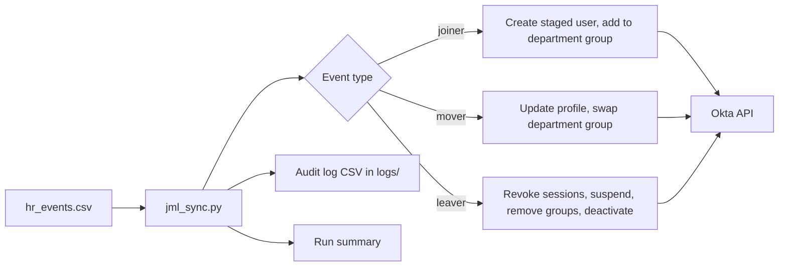

# Okta Joiner / Mover / Leaver Automation

A Python script that reads HR events from a CSV file and applies them to an Okta org through the Okta API. It automates the identity lifecycle: onboarding new hires, handling department changes, and offboarding leavers.

This is a portfolio project built against a free Okta Integrator test org. All names, emails and data in this repo are fake.

## What it does

- **Joiner:** creates the user as staged in Okta and adds them to their department group.
- **Mover:** updates the user's profile (department and title) and moves them from the old department group to the new one.
- **Leaver:** revokes sessions and tokens, suspends the account if it is active, removes department group memberships, then deactivates the user.
- **Audit log:** every action is written to a timestamped CSV file in `logs/`, with a result of OK, SKIPPED or FAILED.
- **Run summary:** each run ends by printing totals for OK, SKIPPED and FAILED.
- **Safe to re-run:** the script looks up current state in Okta before each change and skips work that is already done, so running it twice does not duplicate anything.

## How it works



## Input file

`hr_events.csv` stands in for an HR system. Each row is one event:

| Column | Meaning |
| --- | --- |
| event | `joiner`, `mover` or `leaver` |
| first_name, last_name | The person's name |
| email | Used as the Okta login and the lookup key |
| department | Must match an Okta group: `Sales`, `Engineering` or `Finance` |
| title | Job title |

Example rows (fake data):

```
event,first_name,last_name,email,department,title
joiner,Ben,Carter,ben.carter@example.com,Engineering,Software Engineer
mover,Ben,Carter,ben.carter@example.com,Sales,Sales Engineer
leaver,Chloe,Nguyen,chloe.nguyen@example.com,Finance,Financial Analyst
```

## Requirements

- Python 3.10 or newer
- A free Okta Integrator org used only for testing. Do not use a real company org.
- An Okta API token created in that org
- Three groups in the Okta org named exactly `Sales`, `Engineering` and `Finance`

## Setup

1. Clone the repo and open a terminal in the project folder.
2. Create and activate a virtual environment (Windows PowerShell):

```
py -m venv .venv
.\.venv\Scripts\Activate.ps1
```

3. Install the dependencies:

```
pip install okta python-dotenv
```

4. Copy the example settings file and fill in your own values:

```
Copy-Item .env.example .env
```

   Edit `.env` and set `OKTA_ORG_URL` to your org URL and `OKTA_API_TOKEN` to your token.

5. Edit `hr_events.csv` with the HR events you want to process.

## Run

```
python jml_sync.py
```

## Sample output

```
[SKIPPED] joiner | ben.carter@example.com | create user already exists
[OK] joiner | ben.carter@example.com | add to group Engineering
[SKIPPED] joiner | chloe.nguyen@example.com | add to group user is deactivated
[OK] mover | ben.carter@example.com | update profile Sales / Sales Engineer
[OK] mover | ben.carter@example.com | remove from group Engineering
[OK] mover | ben.carter@example.com | add to group Sales
[SKIPPED] leaver | chloe.nguyen@example.com | deactivate already deactivated

===== RUN SUMMARY =====
Actions logged: 12
  OK: 6
  SKIPPED: 6
  FAILED: 0
Audit log: logs\audit_20261123_191715.csv
```

## Security

- The API token is read from the `.env` file, which is listed in `.gitignore` and is never committed.
- Only `.env.example`, which contains placeholder values, is in the repo.
- Audit logs in `logs/` are also ignored by Git.
- Use fake test users only.

## Limitations and next steps

- Authentication uses an Okta API token. API tokens expire after 30 days of non-use. A better practice for production is an OAuth 2.0 service app with scoped access.
- New users are created as staged. The script does not set credentials or activate them.
- Access is granted through groups only. Assigning applications by role is not implemented yet.
- The suspend step runs only for users whose status is ACTIVE. It has not been exercised against an active user in testing.
- User lookups read the first page of results only. Pagination is not implemented, which is fine for a small test org but not for a large one.
- The Okta Integrator Free Plan limits an org to 10 active users, so testing is small scale.